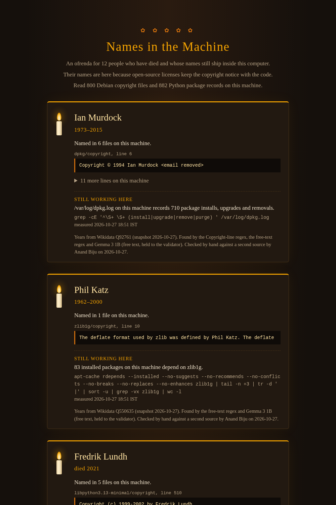

# Names in the Machine

An ofrenda for the people who have died whose names still ship inside your computer.

Line 6 of `/usr/share/doc/dpkg/copyright` on a Debian machine says:

```
Copyright © 1994 Ian Murdock <email removed>
```

(The address is removed here, as it is in everything the tool shows.)

Ian Murdock started Debian. He died in 2015. His name is still on every Debian machine,
because open-source licenses keep the copyright notice with the code, and Debian ships a
copyright file with every package.

`nitm` reads every license and copyright file on the machine, finds the people named there,
checks them against a dated Wikidata snapshot of people who have died, and puts each match in
front of a person to approve by hand. Each approved person gets a quiet card on one static
HTML page: their name, their years, the exact file and line where the name still sits, and one
thing measured on this machine.

Code finds the facts. Gemma 3 1B (`gemma3:1b`, local, through Ollama) reads the free-text
credit lines, one line at a time, and only proposes names. A validator decides which proposals
count. A person approves every card. No model writes a word about anyone.



## What it found on the machine I build on

On 27 Oct 2026 the scan read 1,682 files (800 Debian copyright files and 882 Python METADATA
files). 21 names matched someone on Wikidata who has died. The homonym gate removed 3, and
review by hand turned down 5 more: in each, the person in the file shares a name with someone
who died but is someone else. 12 people are on the page (`docs/ofrenda.html`). 579 names matched
only people with no death date on Wikidata, so they were left off, not guessed.

On the hand-labelled free-text eval (307 lines, 260 names), the free-text regex alone scored
precision 0.960 and recall 0.738. Gemma 3 1B behind the validator scored 0.996 and 0.946, and
regex plus Gemma 0.965 and 0.965. Every number, the commands that produced it, and what went
wrong along the way are in [`logs/run_2026-10-27.txt`](logs/run_2026-10-27.txt).

## Install

```bash
git clone https://github.com/Anandb71/names-in-the-machine
cd names-in-the-machine
python3 -m venv .venv && . .venv/bin/activate
pip install -e '.[test]'
ollama pull gemma3:1b      # optional: only the free-text pass uses it
```

## Run

```bash
nitm scan                        # counts only; working files go to out/ (git-ignored)
nitm scan --no-model             # regex only, never calls Gemma
nitm scan --pip-root ~/code      # also read Python packages in virtualenvs under ~/code
nitm verify                      # y / n / skip for each match
nitm still                       # measure what each approved person's named work still does here
nitm page -o ofrenda.html        # the static page, built from verified.json only
```

The scan runs offline. The Wikidata snapshot in `data/` was fetched once with
`nitm snapshot fetch` and is committed; `nitm snapshot info` shows what is in it.

Not on Debian or Ubuntu? There is no `/usr/share/doc` on macOS or Windows, but the Python
path works anywhere pip runs: `nitm scan --no-docs --pip-root <dir>`.

## How it works

1. **Read.** `/usr/share/doc/*/copyright`, parsed DEP-5-aware, and the `Author` and
   `Maintainer` fields of every `*.dist-info/METADATA`. Each line keeps its file, line number
   and raw text, so every name traces back to where it sits.
2. **Extract.** A Copyright-line regex, an author-field regex, and a free-text regex
   ("written by …", "thanks to …"). Free-text credit lines also go to Gemma, one line per
   call, temperature 0, with email addresses removed, cached by line hash.
3. **Validate.** A name must be an exact substring of its line; 2 to 4 capitalised tokens or
   initials; no digits, `@` or URLs; no org or term words (Inc, Foundation, Project, License,
   Claim, University, GNU, …). GPL, LGPL and MPL template text is stripped before anything
   reads it, and James Hacker, Ty Coon and Gnomovision are denylisted: they never lived.
   Every rejection is logged with the rule that caught it.
4. **Match.** Exact Wikidata label or alias only, diacritics folded and middle initials
   optional. No fuzzy matching and no surname-only matching. The item must be a human (Q5)
   with a death date precise to the year, and have a software or computer-science occupation
   or a link to software that is named in the receipt. A name that matches someone on
   Wikidata with no death date is left off, not guessed.
5. **Verify.** `nitm verify` shows the receipts, the Wikidata item, the years, the occupation
   and any warnings. An approval needs a reason and a second-source URL. Approvals go to
   `verified.json`; turned-down matches stay in `review.local.json` on the machine.
6. **Page.** `nitm page` renders only entries that carry a reviewer, a date, a reason and a
   second source. It refuses to write a page that contains an email address or a word about
   how someone died.

`nitm eval build | freeze | run` is the free-text eval: hand labels, frozen with a sha256
before any model sees the lines, then precision and recall for the regex alone, Gemma alone,
and both. See `docs/eval-labelling.md`.

## Ethics

- The page never states, hints at or links to a cause or circumstances of death.
- A card shows a name, years and receipts. It says "named in dpkg's copyright file", never
  "creator of dpkg", unless the receipt says so.
- Living contributors appear only as counts, never by name. `out/`, `eval/`, `cache/` and
  `review.local.json` name living people, so they are git-ignored and stay on the machine.
  The snapshot stores living people's names only as short hashes.
- Email addresses are stripped from every receipt that is shown.
- No photos, no jump-scares, no ghost puns on real names. The spooky frame belongs to the
  machine, never to the person.

## Corrections

If a card is wrong, or a family asks, it comes down at once.
[Open an issue](https://github.com/Anandb71/names-in-the-machine/issues).

## Data

`data/deceased.json` and `data/no_death_date.txt` come from [Wikidata](https://www.wikidata.org),
whose structured data is CC0 1.0. `data/README.md` has the retrieval date, the counts and
every query. Cause, manner and place of death were never requested.

## Tests

```bash
python -m pytest -q
```

123 tests. They never call the model or the network. They use real lines copied from
`/usr/share/doc` (see `tests/fixtures/README.md`) and a fake Gemma that answers the way the
real one failed: invented relationships, orgs, names that are not in the line.

## License

MIT for the code (see `LICENSE`). The Wikidata snapshot is CC0.
